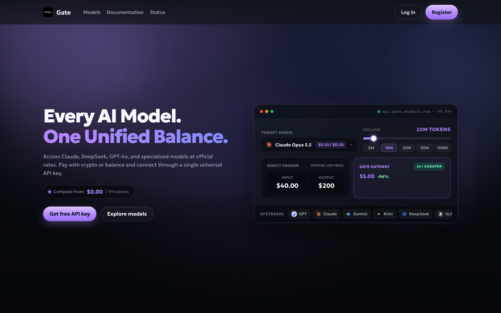
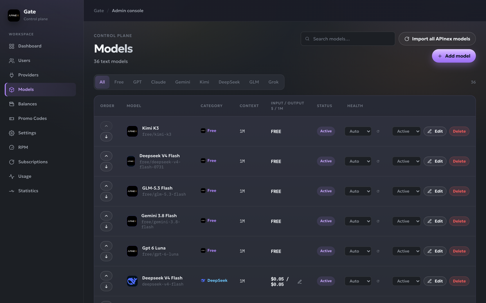

# APInexGate

**APInexGate** is an official open-source AI API gateway and reseller storefront by **[APInex (apinex.bond)](https://apinex.bond)**.

It gives you a ready-to-run, self-hosted AI API proxy with a modern customer dashboard, billing ledger, subscriptions, daily free-tier allowances, RPM rate-limit tiers, promo codes/vouchers, referral rewards, and a full admin panel — powered by a single **[APInex](https://apinex.bond)** upstream key.





---

## Features

- **Drop-In Multi-Protocol AI Gateway**
  - `POST /v1/chat/completions` (OpenAI Chat Completions compatible)
  - `POST /v1/messages` (Anthropic Messages compatible)
  - `POST /v1/responses` (OpenAI Responses compatible)
  - `POST /v1/decisions` (Jev Group Decisions API compatible)
  - `GET /v1/models` (OpenAI model list)
  - Full support for SSE streaming, tool/function calling, reasoning tokens, and typed decisions.
- **1-Click APInex Catalog & Pricing Import**
  - Connect your `sk-apx-...` API key from [apinex.bond](https://apinex.bond) and click **Import all APInex models** in **Admin → Models** to load all free, paid, and Jev Group decision models with official APInex context windows and `$ / 1M` pricing.
  - Edit input/output `$ / 1M` prices at any time to set your own reseller margin.
- **Built-In Monetization & Customer Portal**
  - **Paid Models:** Billed per token (`$ / 1M` input & output) from the customer's USD wallet balance.
  - **Free Models (`free/*`):** Metered against the customer's active subscription token pool or daily free token allowance.
  - **RPM Plans, Subscriptions, Promo Codes & Vouchers:** Grant or sell token subscriptions, RPM upgrades, top-up bonuses, and redeemable balance/subscription vouchers.
  - **White-Label Branding:** Customize `SITE_NAME`, `SITE_URL`, `API_BASE_URL`, and `CONTACT_EMAIL` via `.env`.

---

## Quick Start (4 Commands)

```bash
git clone https://github.com/Apinex-AI/APInexGate.git
cd APInexGate && cp .env.example .env
npm install
npm run dev:full
```

1. Open `.env` and set a strong `ADMIN_PASSWORD`.
2. Start the app with `npm run dev:full` (runs the Fastify API server on `http://127.0.0.1:8787` and Vite frontend on `http://127.0.0.1:5173`).

---

## Configuring Your Gateway in `/admin`

1. **Sign In to Admin:** Open `http://localhost:5173/admin` and log in with your `ADMIN_PASSWORD`.
2. **Add Your APInex Key:**
   - Go to **Admin → Providers** and click **Add key**.
   - Paste your `sk-apx-...` API key from **[apinex.bond](https://apinex.bond)**.
   - APInexGate automatically syncs your upstream USD balance, RPM plan, and active subscription token pool.
3. **Import Models & Set Your Margin:**
   - Go to **Admin → Models** and click **Import all APInex models**.
   - All available paid, `free/*`, and Jev Group decision models are imported automatically with APInex's default `$ / 1M` rates.
   - Click the edit icon next to any paid model's price to set your own custom **Input / Output `$ / 1M`** resale price.

---

## What You Need to Configure Yourself

APInexGate ships as a clean, provider-neutral reseller template without hardcoded third-party payment processors:

1. **Payment Processing (Crypto, Card, or Both):**
   - We do **not** bundle a pre-configured payment processor. To accept automated customer top-ups or subscription checkouts, integrate your own preferred payment method (crypto merchant, card processor such as Stripe/LemonSqueezy, or custom webhook) that credits user balances/subscriptions.
   - Out of the box, you can also sell or distribute **Promo Codes / Vouchers** generated in **Admin → Promos** or credit users directly in **Admin → Users** and **Admin → Subscriptions**.
2. **Google OAuth for Customer Sign-In:**
   - To enable "Continue with Google" on the login and registration pages, create OAuth 2.0 credentials in the Google Cloud Console, set the authorized redirect URI to `<SITE_URL>/api/user/auth/google/callback`, and add `GOOGLE_CLIENT_ID` and `GOOGLE_CLIENT_SECRET` to your `.env`.

---

## Supported API Endpoints

Customers authenticate with their gateway API key (`Authorization: Bearer sk-...` or `x-api-key: sk-...`):

| Endpoint | Protocol | Description |
| :--- | :--- | :--- |
| `GET /v1/models` | OpenAI | Lists active models in your catalog |
| `GET /v1/balance` | Gateway | Spendable USD wallet balance & API key spend limits |
| `GET /v1/subscription` | Gateway | Active subscription token pool or daily free-tier allowance |
| `GET /v1/rpm` | Gateway | Active account RPM limit & tier |
| `POST /v1/chat/completions` | OpenAI Chat | Chat completions (streaming, tools, reasoning) |
| `POST /v1/messages` | Anthropic | Claude Messages API format (streaming, tools) |
| `POST /v1/responses` | OpenAI Responses | Responses API format (streaming, tools) |
| `POST /v1/decisions` | Jev Group Decisions | Typed classification, moderation & scoring |

---

## Environment Variables (`.env`)

| Variable | Default | Description |
| :--- | :--- | :--- |
| `NODE_ENV` | `development` | `development` or `production` |
| `HOST` | `0.0.0.0` | API server bind address |
| `PORT` | `8787` | API server port |
| `DB_PATH` | `./data/gateway.sqlite` | Path to the SQLite database file |
| `ADMIN_PASSWORD` | *(required)* | Password for `/admin` login |
| `SITE_NAME` | `APInexGate` | Public brand name shown across the UI |
| `SITE_URL` | `http://localhost:5173` | Public frontend URL |
| `API_BASE_URL` | `http://localhost:8787/v1` | Public base URL displayed in docs & snippets |
| `API_ORIGIN` | `http://localhost:8787` | Public API origin (used if `API_BASE_URL` is omitted) |
| `CONTACT_EMAIL` | `info@localhost` | Support contact email shown in the UI |
| `CORS_ORIGINS` | `http://localhost:5173` | Comma-separated allowed CORS origins |
| `COOKIE_DOMAIN` | *(optional)* | Optional cookie domain for production subdomains |
| `GOOGLE_CLIENT_ID` | *(optional)* | Google OAuth 2.0 Client ID for customer login |
| `GOOGLE_CLIENT_SECRET` | *(optional)* | Google OAuth 2.0 Client Secret |
| `GOOGLE_REDIRECT_URI` | *(optional)* | Override for `<SITE_URL>/api/user/auth/google/callback` |

---

## Production Build & Verification

```bash
npm run build   # Type-checks and builds frontend (dist/) + server (dist-server/)
npm start       # Starts the Fastify server
npm test        # Runs the automated test suite
npm run ci      # Runs lint + build + test
```

---

## License

Released under the [MIT License](./LICENSE). Built by [APInex (apinex.bond)](https://apinex.bond).
